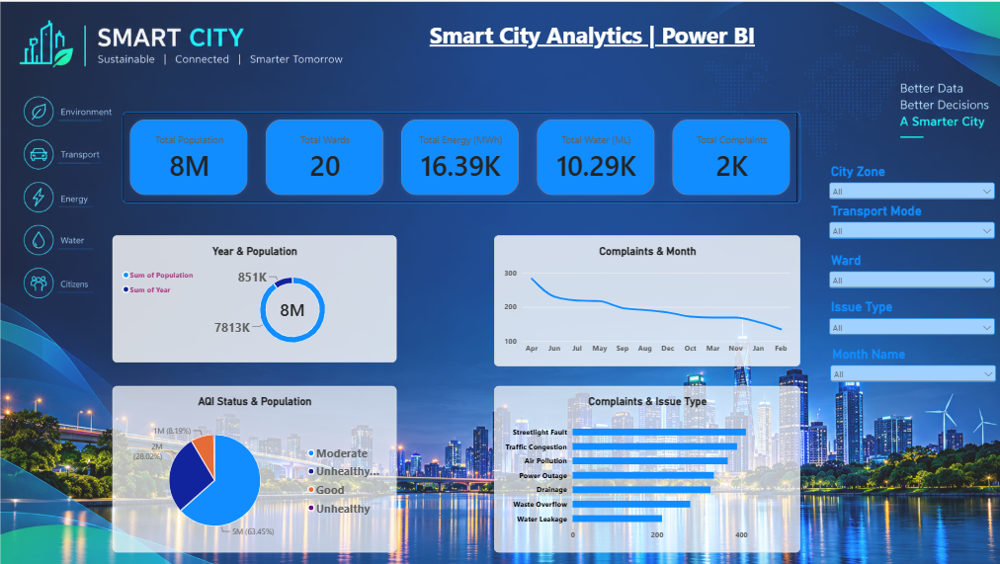

 🏙️ Smart City Analytics Dashboard | Power BI

1. Project Overview

The Smart City Analytics Dashboard is an interactive data visualization project developed using Microsoft Power BI. It focuses on analyzing important smart city indicators such as population, energy consumption, water usage, citizen complaints, transportation, and environmental conditions.

The dashboard provides a centralized view of city performance and helps users explore urban data through interactive visualizations and filters.

2. Project Objectives

- Monitor overall city population and ward distribution.
- Analyze energy consumption and water usage.
- Track monthly citizen complaints.
- Understand Air Quality Index (AQI) status.
- Identify frequently reported city issues.
- Provide meaningful insights through interactive dashboards.

 3. Tools & Technologies Used

- 📊 Microsoft Power BI – Dashboard development and data visualization.
- 📁 Power Query – Data cleaning and transformation (if used).
- 📈 Data Visualization – Charts, KPI cards, and interactive reports.
- 🗂️ Data Analysis – Exploring and understanding smart city indicators.

4. Data Source

Dataset Name: Smart_City_Analytics_Sample_Dataset

The project uses a sample smart city dataset containing information about:

- City population and wards
- Energy consumption
- Water consumption
- Citizen complaints
- Transportation modes
- Environmental and AQI indicators
- Complaint categories and monthly records

*Note: This is a portfolio/practice project using a sample dataset.*

 5. Dashboard Features & Highlights

 A. Key Performance Indicators (KPIs)

The dashboard displays five important KPIs:

| KPI | Dashboard Value |
| Total Population | 8M |
| Total Wards | 20 |
| Total Energy | 16.39K MWh |
| Total Water | 10.29K ML |
| Total Complaints | 2K |

B. Dashboard Visualizations

1. Year & Population Analysis
- Visualizes population-related information.
- Displays population distribution.

2. Complaints by Month
- Analyzes monthly complaint trends.
- Helps identify changes in complaint volume.

3. AQI Status & Population
- Displays the distribution of AQI categories.
- Helps understand environmental indicators.

4. Complaints & Issue Type
- Compares different complaint categories.
- Highlights frequently reported city issues.

C. Interactive Filters

The dashboard includes the following slicers:

- City Zone
- Transport Mode
- Ward
- Issue Type
- Month Name

These filters allow users to explore specific areas and categories.

6. Business Problem

Modern cities generate large amounts of data related to population, transportation, energy, water consumption, and public complaints.

Without a centralized reporting system, understanding city performance and identifying major issues can become difficult.

This dashboard provides a visual reporting solution to explore these indicators in one place.

7. Project Goals

- Simplify smart city data analysis.
- Improve data visibility through interactive reporting.
- Monitor important city performance indicators.
- Identify complaint patterns and environmental trends.
- Support data-driven decision-making.

 8. Key Insights

- The dashboard displays a total population of 8 million.
- The city is represented across 20 wards.
- Total energy consumption is displayed as 16.39K MWh.
- Total water consumption is displayed as 10.29K ML.
- The dashboard tracks approximately 2K complaints.
- Monthly and issue-based visualizations help explore complaint patterns.

9. Dashboard Preview

10. Project Information

| Category | Details |
| Project Name | Smart City Analytics |
| Project Type | Data Analytics |
| Domain | Smart City / Urban Analytics |
| Tool | Microsoft Power BI |
| Dataset | Sample Smart City Dataset |
| Output | Interactive Power BI Dashboard |

11. Future Enhancements

- Integrate real-time smart city data.
- Add advanced environmental analysis.
- Include additional transportation insights.
- Develop predictive analytics features.

 12. Author

**Data Analytics Portfolio Project**

Developed using Microsoft Power BI.

13. Tags

`PowerBI` `DataAnalytics` `SmartCity` `DataVisualization` `BusinessIntelligence` `Dashboard` `DataAnalysis`

---

 If you find this project interesting, feel free to explore the repository
